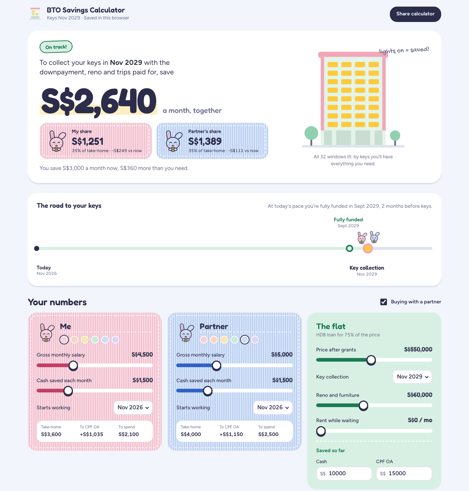

# BTO Savings Calculator

How much do you need to save each month to collect your BTO keys with the downpayment, renovation and holidays paid for?

**[Try it →](https://choonspin.github.io/bto-savings-calculator/)**



## What it does

- **Works backwards from your keys.** Pick the flat price, key collection month and renovation budget, and it finds the smallest monthly saving that covers everything, split between you and a partner by take-home pay.
- **Separates CPF from cash.** CPF Ordinary Account savings pay the downpayment and stamp duty first; cash covers the rest, the renovation and anything else CPF can't pay for.
- **Plans trips along the way.** Add trips with a month and budget. Each comes out of your savings when you go, and the calculator flags any trip you couldn't afford yet.
- **Draws the road to your keys.** A timeline from today to key collection, with start dates, trips and when you'll be fully funded at today's pace.
- **Shows the whole bill.** Downpayment stages, buyer's stamp duty, the HDB loan, the monthly instalment and whether your CPF covers it.
- **Lets each person pick a colour.** Name each person and choose a corduroy colour for their card and bunny.
- **Keeps your numbers private.** Everything is worked out and saved in your browser. Your numbers never leave it; only the fonts and the chart library load from public CDNs.

## Sharing

- **Share calculator** copies a link to the calculator with the example numbers, for anyone working out their own plan.
- **Send my plan** copies a link with your whole plan packed in after the `#`. Browsers never send that part to the website, so the numbers go only to whoever opens the link. If their browser already has a different plan saved, they're asked before it's replaced. Anyone with the link can see your numbers, so send it only to people you'd show them to.

## Assumptions

Estimates only, using 2026 rules. They live in [`src/rules.js`](src/rules.js) so they're easy to update.

| | |
|---|---|
| CPF | Age 35 and below: 20% employee contribution, 23% of wages to the Ordinary Account, S$8,000 monthly wage ceiling |
| Downpayment | 25% with an HDB loan: 2.5% at the agreement for lease, the rest at key collection |
| HDB loan | 75% of the price at 2.6% a year over 25 years; mortgage servicing ratio limit of 30% |
| Interest | 2.5% a year on CPF OA, 3.5% a year on cash savings |
| Stamp duty | Residential buyer's stamp duty bands |

Enter the flat price after any grants you expect.

## Running it

It's a static site with no build step. Serve the folder with any web server (ES modules don't load from `file://`):

```sh
npm start        # python3 -m http.server 8000
npm test         # node --test, no dependencies to install
```

Then open http://localhost:8000.

## Deploying

The site is served by GitHub Pages from the root of the `main` branch. Pushing to `main` publishes it, usually within a minute.

## How it's organised

```
index.html            The page
src/
  main.js             Wires the page together: config, saving, events
  plan.js             The plan's shape, example numbers and validation
  projection.js       Month-by-month projection and the savings solver
  rules.js            Singapore CPF, HDB and stamp duty rules
  months.js           'YYYY-MM' month helpers
  format.js           Money and text formatting
  storage.js          Saving to this browser (or a shared claude.ai store)
  share-link.js       Packing a plan into a link and back
  styles.css
  ui/
    view.js           Hero, cards, bill and key collection day
    timeline.js       The road to your keys
    trips.js          Trip boarding passes
    month-picker.js   The calendar for choosing a month
    chart.js          The savings chart (Chart.js)
    art.js            The corduroy bunny and the HDB block
    dom.js            Small DOM helpers
test/                 Tests for the rules, plan, projection and share links
```

The calculation code (`plan.js`, `projection.js`, `rules.js`, `months.js`, `share-link.js`) never touches the page, so it's tested directly with Node.

## Configuring a copy

A copy of the page can change its settings in the `#planner-config` block in `index.html`:

```html
<script type="application/json" id="planner-config">
  {
    "title": "Our BTO Savings Calculator",
    "place": "Tampines",
    "pricePresetsLabel": "4-room",
    "pricePresets": [{ "label": "4-room, lowest", "price": 420000 }],
    "storage": "browser"
  }
</script>
```

| Option | Default | |
|---|---|---|
| `title` | `BTO Savings Calculator` | Page and header title |
| `place` | none | Shown before the keys date in the header |
| `pricePresets`, `pricePresetsLabel` | none | Quick-pick price buttons under the price slider |
| `storage` | `browser` | `shared` keeps one plan for everyone viewing a claude.ai artifact copy |
| `storageKey` | `bto-savings-calculator` | Browser storage key |
| `sharedDoc` | `plans/main` | Document path in the shared store |
| `shareUrl` | this page | The calculator that **Share calculator** and **Send my plan** link to |
| `allowReset` | `true` | Show **Reset to example numbers** |

## License

[MIT](LICENSE)
